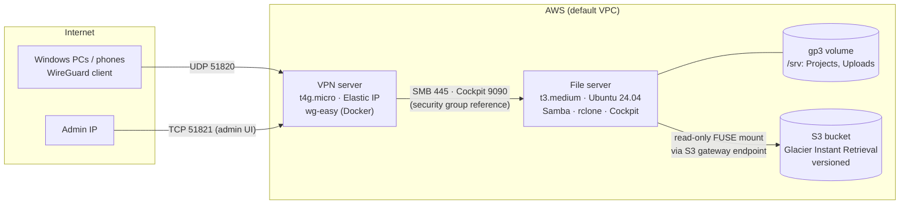

# WireGuard + Samba + S3 archive on AWS

A small-office file server in AWS, reachable only over a VPN, with a
multi-terabyte archive kept in S3 Glacier Instant Retrieval and exposed to
Windows users as an ordinary read-only network drive.

Built as a proof of concept for moving an office off a shelf of external
hard drives: employees keep mapping `P:` and `A:` drives like before, the
archive costs about $5 per TB per month, and nothing on the file server is
reachable from the internet.



## What it does

| Share      | Backed by        | Behaviour                                                          |
|------------|------------------|--------------------------------------------------------------------|
| `Projects` | EBS (gp3)        | Read-write. One folder per access zone, open only to that group.   |
| `Uploads`  | EBS (gp3)        | Write-once drop folder: files can be added, never changed or deleted. |
| `Archive`  | S3 (Glacier IR)  | Read-only view of `s3://<bucket>/<zone>/`, one mount per zone.     |

- **Access zones**: each zone is one Linux group, one folder in `Projects` and
  `Uploads`, and one read-only rclone mount of the matching bucket prefix.
  `sudo fileserver-add-zone team-c` adds a new one.
- **Users only see what they can open** (`access based share enum`,
  `hide unreadable`), so a user in `team-a` never sees `team-b` folders.
- **Admin from the browser**: Cockpit with the Files page and 45Drives
  Identities (users, groups, Samba passwords). VPN devices and QR codes are
  managed in the wg-easy UI.

## Design decisions

- **Two instances, one entry point.** Only the VPN server has a public port.
  The file server's security group accepts traffic only from the VPN
  server's security group, so SMB is never exposed even if a rule is
  mistyped. Either box can be rebuilt without touching the other.
- **Split tunnel.** Device configs route only the VPC CIDR through the
  tunnel; browsing and video calls stay on the local connection.
- **No SSH anywhere.** Shells go through SSM Session Manager. IMDSv2 is
  required on both instances.
- **No secrets in user-data or on disk.** Admin passwords are generated by
  Terraform, stored as SSM SecureString parameters, and fetched at boot by
  each instance through a role that can read only its own parameter.
- **Least-privilege archive access.** The file server role can list and read
  the bucket, not write or delete. The bucket denies non-TLS requests,
  blocks public access, enforces bucket-owner object ownership and keeps old
  versions for 30 days.
- **Data outlives the instance.** Project files live on a separate encrypted
  gp3 volume. The setup script formats it only if it is blank and mounts it
  by UUID, so changing user-data replaces the instance and keeps the files.
- **Write-once uploads with plain POSIX.** Upload folders are owned by a
  service user with mode `3770` (setgid + sticky) and Samba forces new files
  to `0440` owned by the folder owner: members can add files but not edit,
  rename or delete them, with no ACL tooling needed.
- **Archive as a filesystem.** `rclone mount --read-only --vfs-cache-mode full`
  with a size-capped local cache per zone: the first open of a file comes
  from S3, later opens from local disk. `--use-server-modtime` avoids a
  metadata request per file when listing large folders. S3 traffic goes
  through a free gateway VPC endpoint.

## Testing without AWS

The user-data scripts are plain bash (Terraform prepends `export` lines
instead of templating them), so they run unchanged in Docker:

```bash
./terraform/poc/test/run-fileserver-test.sh   # 23 checks
./terraform/poc/test/run-vpn-test.sh          # 12 checks
```

- An Ubuntu 24.04 container with **systemd as PID 1** runs the real script:
  apt, systemd units, FUSE mounts, Samba, Cockpit.
- A **loop device** stands in for the EBS volume, so the format, fstab and
  mount path is exercised, and the script runs a **second time** to prove
  it is idempotent against an existing volume.
- **`rclone serve s3`** stands in for the bucket.
- Throwaway users then run a permission suite over real SMB3 connections
  (`terraform/poc/test/share-permissions.sh`): zone isolation, read-only archive, write-once uploads,
  wrong passwords.
- The VPN test runs **Docker inside the container**, starts wg-easy with the
  unattended settings, logs in to its API, creates a device and checks the
  generated config (endpoint, split-tunnel `AllowedIPs`).

CI runs `terraform fmt`/`validate`,
ShellCheck and both test suites.

## Deploy

Requires Terraform >= 1.16.5 and AWS credentials.

```bash
# once: state bucket
cd terraform/bootstrap
terraform init && terraform apply -var state_bucket_name=<unique-name>

# the stack
cd ../poc
cp backend.hcl.example backend.hcl            # set the bucket name
cp terraform.tfvars.example terraform.tfvars  # set admin_cidr to your IP
terraform init -backend-config=backend.hcl
terraform apply
terraform output
```

Setup takes about 3 minutes after apply. Progress:
`/var/log/fileserver-setup.log` and `/var/log/vpn-setup.log`.

Then:

1. **VPN**: open `wg_easy_url` from your admin IP, log in as `admin` with the
   password from `get_passwords.wg_easy`, add a device, import the `.conf`
   in the WireGuard app (or scan the QR code on a phone).
2. **Admin**: with the VPN on, open `cockpit_url` and log in as `fsadmin`
   (password from `get_passwords.cockpit`). Turn on *Administrative access*.
3. **Users**: in *Identities*, create a user with groups `staff` and a zone
   (e.g. `team-a`), set a Samba password.
4. **Archive data**:
   `aws s3 cp ./folder s3://<archive_bucket>/team-a/ --recursive --storage-class GLACIER_IR`
5. **Windows**: map `\\<fileserver_private_ip>\Projects` (and `Archive`,
   `Uploads`) as `WORKGROUP\<user>`.
6. **Speed**: `iperf3 -c <fileserver_private_ip>` gives the network ceiling;
   compare with a large file copy.

Tear down with `terraform destroy` (the PoC bucket has `force_destroy`).

## Cost (eu-central-1, on demand, approximate)

| Item                                 | Per month |
|--------------------------------------|-----------|
| t3.medium file server                | ~$35      |
| t4g.micro VPN server                 | ~$7       |
| Public IPv4 addresses (2)            | ~$7       |
| gp3 storage (60 GB in total)         | ~$6       |
| S3 Glacier IR storage                | ~$5 / TB  |

Glacier IR retrieval is billed at about $0.03 per GB read, so the local
rclone cache matters for files people open often.

## PoC limits and next steps

- Data volume 30 GB, no snapshots. Production: larger volume plus daily
  snapshots via Data Lifecycle Manager.
- wg-easy UI over plain HTTP, restricted to one IP. Production: TLS in
  front of it, or reach it only through the tunnel.
- The archive is read-only from the server. Ingest is manual
  (`aws s3 sync`); a verified "archive this finished project" command is the
  next step and needs `s3:PutObject` (still no delete) on the server role.
- Samba `full_audit` logging for sensitive zones is not set up yet.
- The iperf3 port is for the PoC only.
- The private IP changes when the file server is replaced; pin it or add a
  private DNS name before handing out mapped drives.
